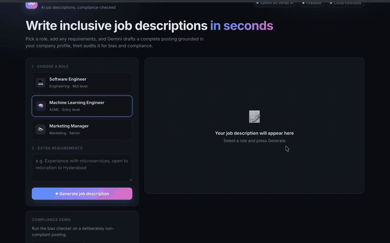
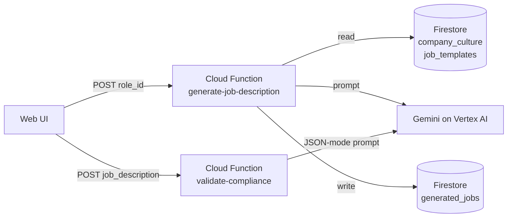

# AI Job Description Generator on Google Cloud
   
A serverless HR automation service that generates role-specific, inclusive job descriptions with **Gemini on Vertex AI**, grounded in company and role data stored in **Firestore**, and reviews them for compliance issues — exposed as **Cloud Functions (gen2)** HTTP APIs.

## Architecture



1. `generate-job-description` loads the company profile and a role template from Firestore, builds a structured prompt, calls Gemini, and stores the result in `generated_jobs`.
2. `validate-compliance` asks Gemini (JSON response mode, low temperature) to score the text 1–10 for bias, discriminatory requirements and missing EEO statements, then validates the returned JSON.

## Tech stack

Python 3.12 · Cloud Functions gen2 (Cloud Run) · Vertex AI Gemini (`google-genai` SDK) · Firestore (Native mode) · IAM least-privilege service account · pytest · GitHub Actions

## Project layout

```
functions/        Cloud Function source (both entry points) + requirements
scripts/          deploy.sh, seed_firestore.py, cleanup.sh
frontend/         Single-page UI that calls both APIs
tests/            Unit tests with mocked Firestore / Gemini
```

## Deploy

Requires the `gcloud` CLI and a GCP project with billing enabled.

```bash
gcloud auth login && gcloud auth application-default login
pip install google-cloud-firestore
PROJECT_ID=<your-project> ./scripts/deploy.sh
```

The script enables APIs, creates Firestore, creates a dedicated service account with only `aiplatform.user` and `datastore.user`, seeds data, deploys both functions and prints their URLs.

## Try it

```bash
curl -X POST "$GEN_URL" -H "Content-Type: application/json" \
  -d '{"role_id": "ml_engineer", "custom_requirements": "Experience with Vertex AI"}'

curl -X POST "$COMPLIANCE_URL" -H "Content-Type: application/json" \
  -d '{"job_description": "Software Engineer, must be under 35 years old"}'
# -> {"success": true, "score": 2, "issues": [...], "recommendations": [...]}
```

Or open `frontend/index.html`, paste both URLs, and generate.

## Tests

```bash
pip install -r functions/requirements.txt pytest
pytest -q
```

## Cleanup

```bash
./scripts/cleanup.sh            # remove functions
gcloud projects delete <project> # remove everything
```

## Changes from the reference recipe

Built from the [Automated Job Description Generation with Gemini and Firestore](https://github.com/mzazon/cloud-projects/blob/main/gcp/job-description-generation-gemini-firestore/job-description-generation-gemini-firestore.md) recipe in mzazon/cloud-projects, with these changes:

- Migrated from the deprecated `vertexai.generative_models` SDK and retired `gemini-1.5-flash` to the `google-genai` SDK; model is configurable via `GEMINI_MODEL`
- Compliance check uses JSON response mode plus server-side validation, returning structured `score / issues / recommendations` instead of free text
- Dedicated least-privilege service account instead of the default compute account
- Lazy client initialisation and pure prompt-building functions so the logic is unit-testable without GCP
- Added an ML Engineer template, a web UI, unit tests and CI
- Fixed the recipe's deploy so the compliance function ships from the same source as its entry point

## Possible extensions

Authenticated endpoints (Identity Platform / API Gateway), Cloud Translation for multilingual output, response caching in Firestore, and Terraform for infrastructure.
